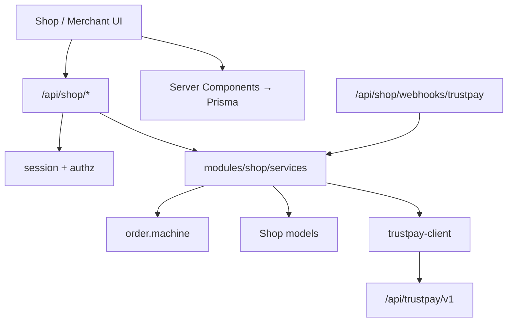

# PlusBuy — System Architecture

## Runtime shape

PlusBuy is implemented as App Router routes inside a single Next.js 15 application:

- `src/app/(shop)` — buyer pages
- `src/app/(merchant)` — merchant pages
- `src/app/api/shop` — shop HTTP API
- `src/modules/shop` — domain machine + order services
- `src/lib/trustpay-client.ts` — outbound TrustPay adapter
- `src/components/shop` — UI components

Postgres holds shop tables. TrustPay tables coexist in the same database but are a separate bounded context.

## Layering

## Integration boundary

PlusBuy may import:

- `src/lib/trustpay-client`
- `src/contracts/trustpay`

PlusBuy must not import `src/modules/trustpay` or Prisma `Tp*` models (enforced by `tests/architecture.test.ts`).

## Key flows

1. **Create order:** validate BUYER → create `Order` + items → `createPayment` → store `paymentId`/`checkoutUrl`.
2. **Webhook held:** verify signature → `PAYMENT_HELD` → `PAID_IN_ESCROW`.
3. **Item received:** `releasePayment` → `ITEM_RECEIVED` → `COMPLETED`.
4. **Dispute:** `openDispute` → `DISPUTE_OPENED` → `DISPUTED`.
5. **Cancel paid:** `refundPayment` → `CANCEL_REQUESTED` → `CANCELLED` (refunded via later webhook/reconcile).

## Diagram

See [plusbuy_component_architecture.mmd](../03_SYSTEM_DESIGN_AND_ARCHITECTURE/diagrams/plusbuy_component_architecture.mmd).
