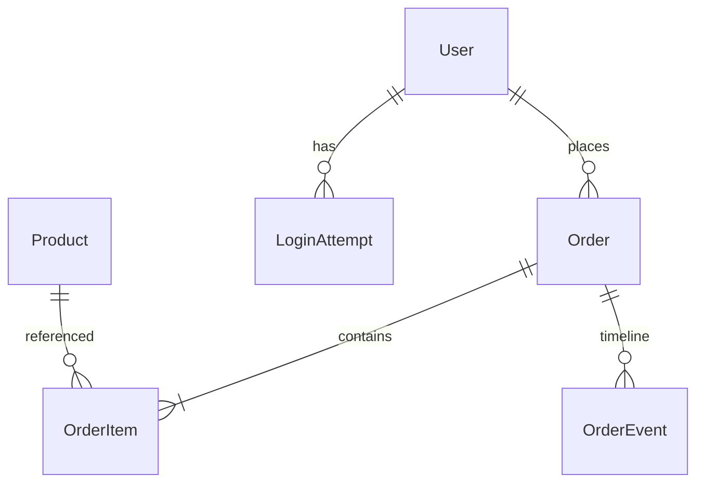

# PlusBuy — Database Design

Shop tables live in PostgreSQL via Prisma (`prisma/schema.prisma`). TrustPay `Tp*` tables share the same database but are documented under TrustPay.

## Entity relationship (shop)

## Tables

### User
| Column | Type | Notes |
|--------|------|-------|
| id | String (cuid) PK | |
| name | String | |
| email | String unique | |
| phone | String? | |
| passwordHash | String | bcrypt |
| role | Role enum | BUYER, MERCHANT, TRUSTPAY_ADMIN |
| createdAt | DateTime | |

### LoginAttempt
Throttle store: email, optional userId, success, createdAt. Indexed `(email, createdAt)`.

### Product
| Column | Type | Notes |
|--------|------|-------|
| id | cuid PK | |
| name, description | String | |
| priceMinor | Int | pesewas |
| colorHex | String | default slate |
| imageUrl | Text? | optional data URL / URL |
| stock | Int | |
| active | Boolean | |
| createdAt | DateTime | |

### Order
| Column | Type | Notes |
|--------|------|-------|
| id | cuid PK | |
| code | String unique | e.g. PB-1000 |
| buyerId | FK to User | |
| status | OrderStatus | see machine |
| totalMinor | Int | |
| currency | String | default GHS |
| paymentId | String? | TrustPay payment id |
| checkoutUrl | String? | |
| deliveryNote | String? | |
| version | Int | optimistic concurrency |
| shippedAt, completedAt | DateTime? | |
| createdAt, updatedAt | DateTime | |

Indexes: `(buyerId, createdAt)`, `status`.

### OrderItem
Snapshot of name/unit price; quantity; FKs to Order and Product. Cascade delete with order.

### OrderEvent
Audit trail: type, message, actor, createdAt. Index `(orderId, createdAt)`.

### ProcessedWebhook
`eventId` PK — TrustPay webhook dedupe.

### OrderSequence
Singleton `id=1`, `nextVal` for PB codes.

## OrderStatus enum
`PENDING_PAYMENT`, `PAID_IN_ESCROW`, `SHIPPED`, `COMPLETED`, `DISPUTED`, `REFUNDED`, `CANCELLED`.

## Transaction considerations
Order create, transitions, and webhook application use Prisma transactions where required. Money never stored as float.
