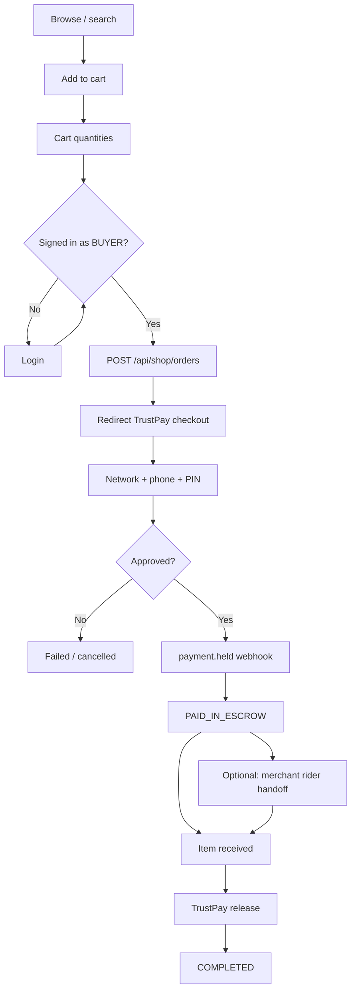

# PlusBuy — User Workflows

## Buyer purchase (implemented)

## Buyer dispute

PAID_IN_ESCROW or SHIPPED → Report problem → TrustPay dispute + order DISPUTED → Admin resolves refund or release → webhook updates order.

## Merchant rider handoff

PAID_IN_ESCROW → Hand to rider → SHIPPED. Payment remains HELD until buyer release. **Current PlusBuy ship route does not call TrustPay recordShipment.**

## Merchant payout

View available balance → POST payout with network + phone → TrustPay simulated payout completes after short delay.
