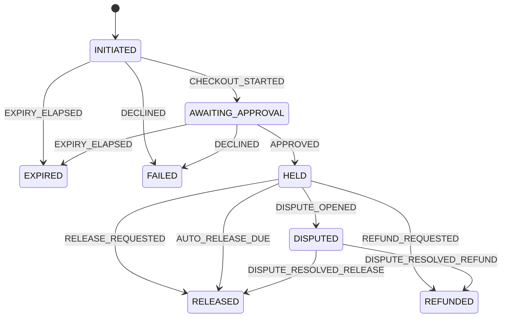

# TrustPay — Payment Lifecycle and State Management

## State machine (implemented)

Source: `src/modules/trustpay/domain/payment.machine.ts`.

## Shipment
Does not change status. Sets `shippedAt` and `autoReleaseAt` (AUTO_RELEASE_DAYS, default 7) while HELD.

## Terminal
RELEASED, REFUNDED, FAILED, EXPIRED.
