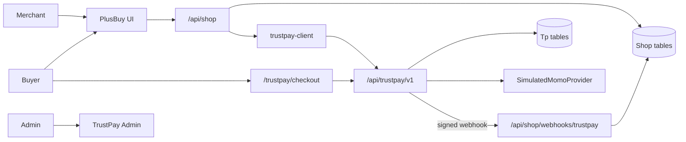

# Overall Ecosystem Architecture

## Current system
One Next.js app, one Postgres database, two bounded contexts: PlusBuy (shop) and TrustPay (payments/escrow).

## Proposed future (not implemented)
Separate TrustPay deployable with live MoMo PSP and licensed safeguarded accounts. Keep HTTP+webhook contract.
