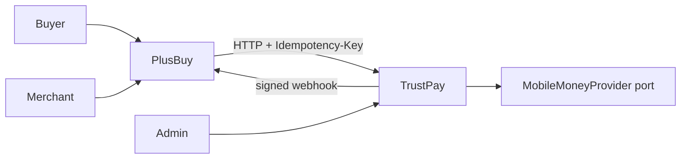

# PlusBuy + TrustPay Documentation

This folder documents the **actual** PlusBuy and TrustPay implementation in this repository. Proposed or future behaviour is labelled separately and must not be read as live capability.

## Ecosystem introduction

**PlusBuy** is a single-seller e-commerce demo. Buyers browse products, build a multi-item cart, check out with TrustPay, and confirm receipt so funds can be released. The merchant manages products, rider handoff, ledger and MoMo withdrawals.

**TrustPay** is a separate logical payment and escrow service living in the same Next.js process and Postgres database. It exposes a versioned HTTP API, a simulated Mobile Money checkout, a double-entry ledger, webhook outbox delivery, and an admin console.

**Relationship:** PlusBuy never imports TrustPay domain modules. It calls TrustPay only through `src/lib/trustpay-client.ts` and shared Zod contracts in `src/contracts/trustpay.ts`. TrustPay notifies PlusBuy with signed webhooks. Shop and TrustPay tables are separate (`User`/`Order`/`Product` vs `Tp*`).

## Architecture overview

Runtime Mobile Money is **simulated** (`SimulatedMomoProvider`). No real money moves. A `RealMtnMomoProvider` stub exists but is not wired.

## Current implementation status

| Area | Status |
|------|--------|
| Buyer browse / search / cart / multi-item checkout | Implemented |
| TrustPay escrow hold / release / refund / dispute | Implemented (simulated MoMo) |
| Merchant products, rider handoff, ledger, payouts | Implemented |
| TrustPay admin (payments, disputes, webhooks, demo) | Implemented |
| Live MTN/Telecel/AT MoMo collection | Not implemented (stub only) |
| Buyer self-registration / password reset | Not implemented |
| Contact form | Not implemented (landing copy only) |
| Real licensed escrow / safeguarded funds | Not implemented — demo ledger only |

## Important technical assumptions

- Money is integer **pesewas** (`*Minor`), currency **GHS**. Never floats.
- Status changes use transition tables; illegal transitions return `409 invalid_transition`.
- Ledger is source of truth for TrustPay balances.
- Auth: JWT cookie `pb_session` (PlusBuy roles); TrustPay merchant API uses Bearer `tp_test_…` keys.
- Demo accounts (password `Demo@1234`): `john@plusbuy.demo` (BUYER), `merchant@plusbuy.demo` (MERCHANT), `admin@trustpay.demo` (TRUSTPAY_ADMIN).

## Known limitations

- Simulated PIN approval is not a carrier MoMo prompt.
- Shop no longer arms TrustPay auto-release via shipment; buyer **Item received** releases funds from `PAID_IN_ESCROW` or `SHIPPED`.
- Product delete API does not exist; products are deactivated via `active`.
- Admin demo reset truncates both shop and TrustPay tables (boundary caveat).

## Documentation navigation

### PlusBuy

1. [Project Overview](01_PLUSBUY/01_Project_Overview.md)
2. [Background and Problem Statement](01_PLUSBUY/02_Project_Background_and_Problem_Statement.md)
3. [Functional Requirements](01_PLUSBUY/03_Functional_Requirements.md)
4. [Non-Functional Requirements](01_PLUSBUY/04_Non_Functional_Requirements.md)
5. [System Architecture](01_PLUSBUY/05_System_Architecture.md)
6. [Component Architecture](01_PLUSBUY/06_Component_Architecture.md)
7. [Database Design](01_PLUSBUY/07_Database_Design.md)
8. [API Documentation](01_PLUSBUY/08_API_Documentation.md)
9. [User Roles and Permissions](01_PLUSBUY/09_User_Roles_and_Permissions.md)
10. [User Workflows](01_PLUSBUY/10_User_Workflows.md)
11. [Security Architecture](01_PLUSBUY/11_Security_Architecture.md)
12. [Deployment and Configuration](01_PLUSBUY/12_Deployment_and_Configuration.md)
13. [Testing Strategy](01_PLUSBUY/13_Testing_Strategy.md)
14. [Future Improvements](01_PLUSBUY/14_Future_Improvements.md)

### TrustPay

1. [Service Overview](02_TRUSTPAY/01_Service_Overview.md)
2. [Business Requirements](02_TRUSTPAY/02_Business_Requirements.md)
3. [Functional Requirements](02_TRUSTPAY/03_Functional_Requirements.md)
4. [Non-Functional Requirements](02_TRUSTPAY/04_Non_Functional_Requirements.md)
5. [Service Architecture](02_TRUSTPAY/05_Service_Architecture.md)
6. [Payment Processing Architecture](02_TRUSTPAY/06_Payment_Processing_Architecture.md)
7. [Escrow Management Architecture](02_TRUSTPAY/07_Escrow_Management_Architecture.md)
8. [Database Design](02_TRUSTPAY/08_Database_Design.md)
9. [API Documentation](02_TRUSTPAY/09_API_Documentation.md)
10. [Payment Lifecycle and State Management](02_TRUSTPAY/10_Payment_Lifecycle_and_State_Management.md)
11. [Webhooks and Event Processing](02_TRUSTPAY/11_Webhooks_and_Event_Processing.md)
12. [Refunds and Dispute Management](02_TRUSTPAY/12_Refunds_and_Dispute_Management.md)
13. [Security and Financial Integrity](02_TRUSTPAY/13_Security_and_Financial_Integrity.md)
14. [Reconciliation and Audit Trail](02_TRUSTPAY/14_Reconciliation_and_Audit_Trail.md)
15. [Deployment and Configuration](02_TRUSTPAY/15_Deployment_and_Configuration.md)
16. [Testing Strategy](02_TRUSTPAY/16_Testing_Strategy.md)
17. [Future Improvements](02_TRUSTPAY/17_Future_Improvements.md)

### System design

1. [Overall Ecosystem Architecture](03_SYSTEM_DESIGN_AND_ARCHITECTURE/01_Overall_Ecosystem_Architecture.md)
2. [Service Communication Architecture](03_SYSTEM_DESIGN_AND_ARCHITECTURE/02_Service_Communication_Architecture.md)
3. [Data Flow Architecture](03_SYSTEM_DESIGN_AND_ARCHITECTURE/03_Data_Flow_Architecture.md)
4. [Transaction Sequence Architecture](03_SYSTEM_DESIGN_AND_ARCHITECTURE/04_Transaction_Sequence_Architecture.md)
5. [Database Relationship Architecture](03_SYSTEM_DESIGN_AND_ARCHITECTURE/05_Database_Relationship_Architecture.md)
6. [Security and Trust Boundaries](03_SYSTEM_DESIGN_AND_ARCHITECTURE/06_Security_and_Trust_Boundaries.md)
7. [Deployment Architecture](03_SYSTEM_DESIGN_AND_ARCHITECTURE/07_Deployment_Architecture.md)
8. [Architectural Decisions](03_SYSTEM_DESIGN_AND_ARCHITECTURE/08_Architectural_Decisions.md)
9. [Diagrams](03_SYSTEM_DESIGN_AND_ARCHITECTURE/diagrams/)
