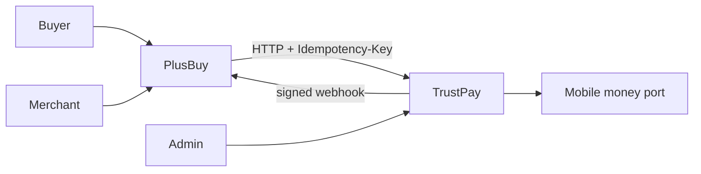
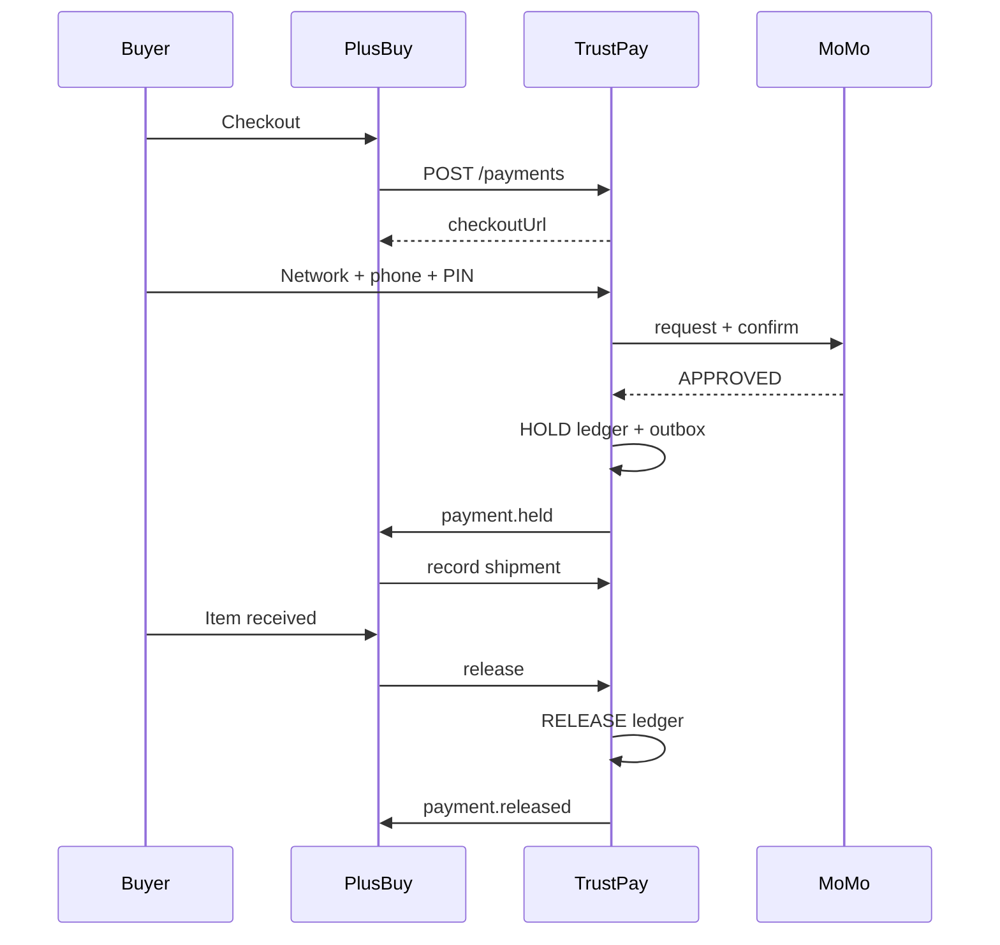
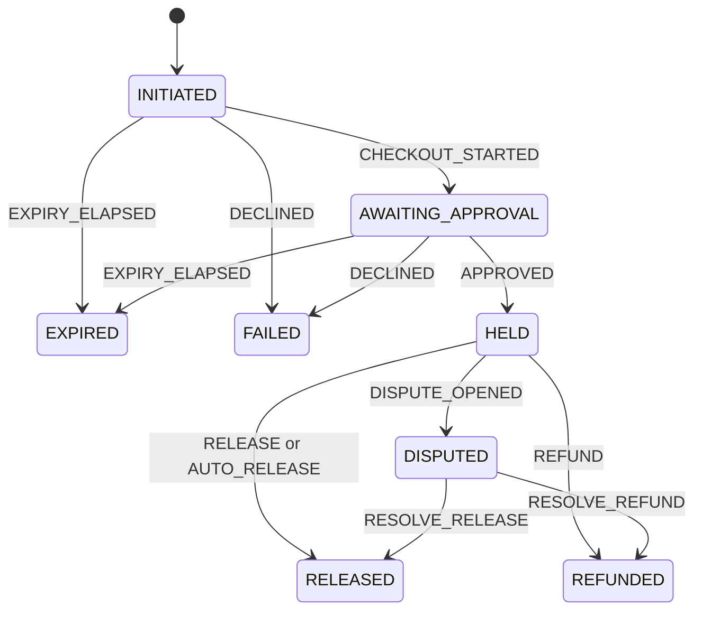
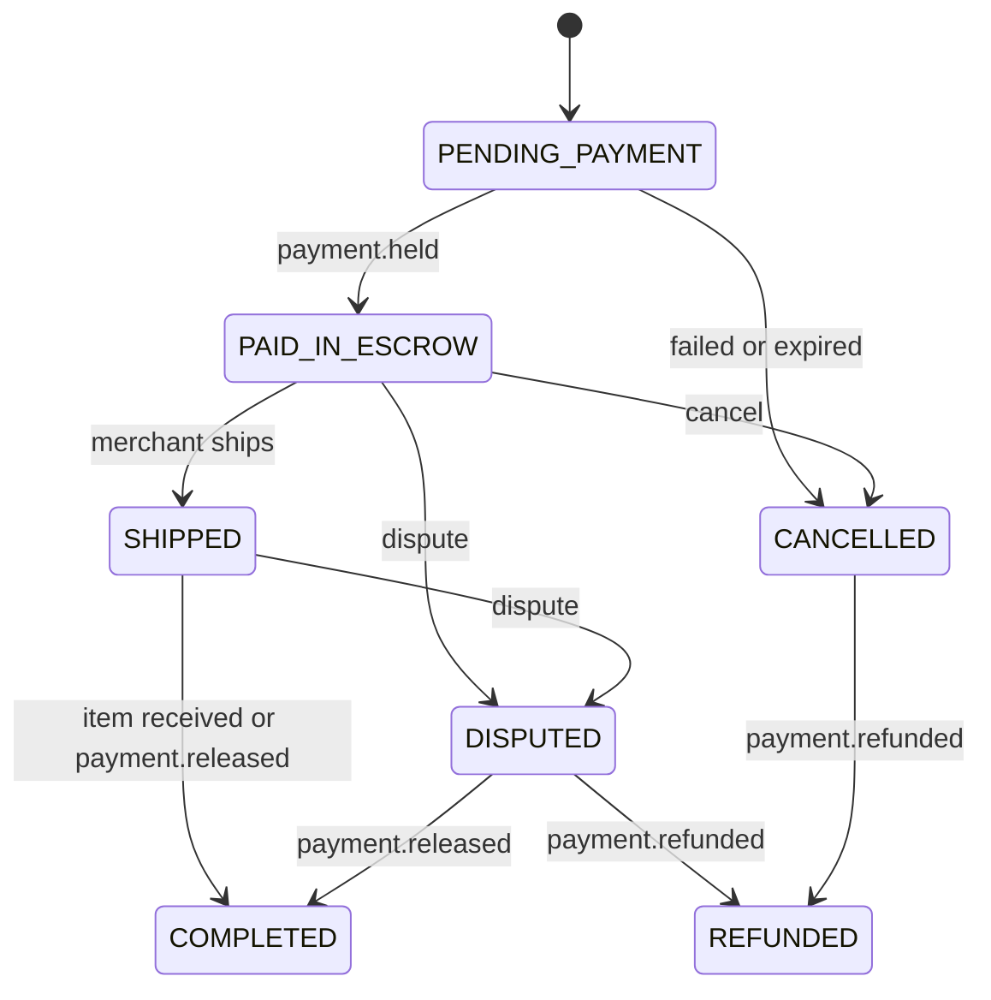

# Architecture

PlusBuy and TrustPay live in one Next.js app and one Postgres database. They are separate bounded contexts. Shop code calls TrustPay only through `src/lib/trustpay-client.ts` and the zod contracts in `src/contracts/trustpay.ts`.

## Contexts

## Escrow sequence

## Payment states

`recordShipment` is allowed only while `HELD`. It sets `shippedAt` and `autoReleaseAt` and does not change status. Disputed payments are not auto-released.

## Order states

## Ledger example

A GH₵ 120.00 shirt (`12000` pesewas) at 150 bps:

- HOLD: `BUYER_WALLET -12000`, `ESCROW +12000`
- RELEASE: fee `180`, net `11820`. `ESCROW -12000`, `MERCHANT_AVAILABLE +11820`, `TRUSTPAY_REVENUE +180`
- REFUND (no fee): `ESCROW -12000`, `BUYER_REFUNDED +12000`
- WITHDRAWAL of the net: `MERCHANT_AVAILABLE -11820`, `MERCHANT_WITHDRAWN +11820`

Every transaction sums to zero. Balances are sums of immutable entries.
